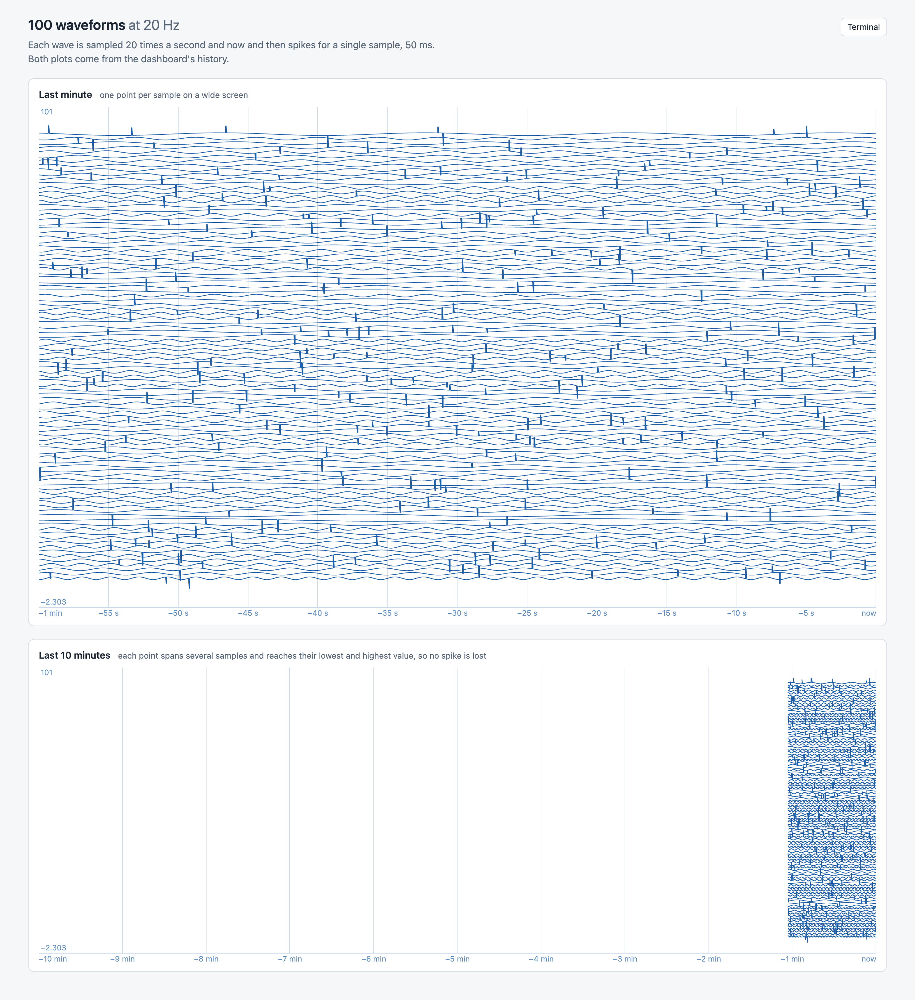
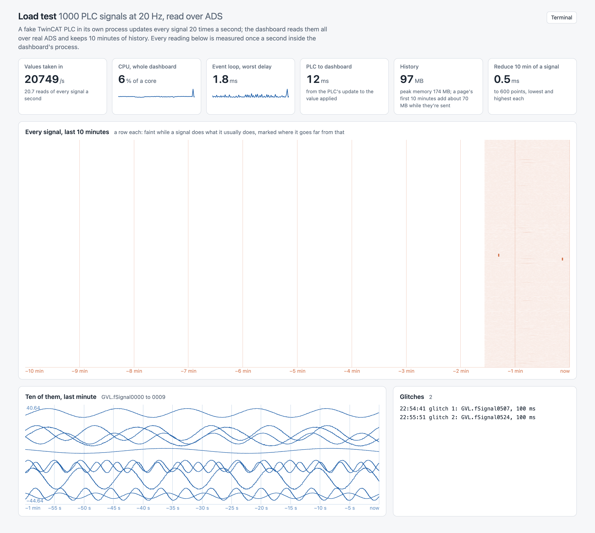

# Sightglass

Live dashboards for a running program, a microcontroller, or anything that
can make an HTTP request. Send values by name and they appear in the browser
(or the terminal) as they change: a window onto a running system, like the
sight glass on a tank.


That's the launch control demo; run it with one command:

```bash
uvx --from "sightglass[web]" sightglass --demo launch --open
```

It's a plain HTML page fed live by three separate programs: an in-process
source, another process using `Client`, and plain HTTP posts. Its gauges,
tanks and lamps are drawn by CSS from the values; the page has no JavaScript
of its own. The source is in [src/sightglass/launch/](https://github.com/davidson-engineering/sightglass/tree/main/src/sightglass/launch).

Add `--theme terminal` for a phosphor-terminal look ([themes](#themes)), or
`--terminal` and the same launch is drawn in the terminal as well, laid out by
a screen function of its own ([screen.py](https://github.com/davidson-engineering/sightglass/blob/main/src/sightglass/launch/screen.py)):


- **One line to start.** `start()` serves a dashboard in the background and
  prints its address; `monitor.set("progress", 5)` works from any thread, and
  elements appear the first time you use them.
- **No code needed.** Pipe a program into `sightglass`, `curl` values to it,
  or point it at a serial port, a ZeroMQ socket or a Beckhoff PLC.
- **Any language.** `POST /update` with JSON or `key=value` lines.
- **Keeps up with fast devices.** Serial and ZeroMQ are read on background
  threads and drained completely, so the display never falls behind and a
  stalled device can't freeze it.
- **Honest about staleness.** Pages reconnect by themselves, show how old the
  data is, and dim values while disconnected or (optionally) when a source
  goes quiet; a page fed by several sources can show which one stopped.
- **Plain HTML dashboards.** Mark any element `data-bind="<id>"` and it stays
  live; CSS can turn values into gauges, levels and lamps, like the page
  above. Otherwise a clean generic page is generated.
- **See what actually arrives.** Press `` ` `` on any dashboard page for the
  [signals view](#signals-view): every id received, its value as sent and a
  chart of its last minute, so a misspelt id or a feed that stopped is obvious.

## Install

Requires Python 3.11+.

```bash
pip install "sightglass[web]"        # add serial, zmq, ads, rest, influxdb, or use [all]
```

Try it: `sightglass --demo launch --open` runs the page above;
`sightglass --demo --open` shows every kind of display on the generic page.

## Quick start

### From inside a Python program

```python
import time

from sightglass import start

monitor = start()  # prints "Dashboard: http://127.0.0.1:8080/"

for i in range(1, 101):
    time.sleep(0.1)  # your work
    monitor.set("progress", i)
    monitor.set("status", "running" if i < 100 else "done")
```

`set()` returns immediately and is safe from any thread. Each new id becomes
an element (a lamp for `True`/`False`, text otherwise; ids like `"job.rate"`
are grouped under `job`). Long floats are shortened to 6 significant digits.
The dashboard stops when your program exits, or call `monitor.stop()`.

### Without writing code

```bash
# Pipe a program: lines like "progress=5 status=running" or JSON objects
# become values; everything else is printed as usual.
my_program | sightglass

# Push values from anything: shell scripts, cron jobs, other languages.
sightglass &
curl -d 'temperature=21.5 status=ok' http://127.0.0.1:8080/update
curl -d '{"job": {"progress": 5}}' http://127.0.0.1:8080/update
curl http://127.0.0.1:8080/values     # what the dashboard shows, as JSON

# Read a device.
sightglass --serial auto --csv temperature,humidity
sightglass --zmq tcp://localhost:5556
sightglass --ads 5.12.34.56.1.1 --vars 'MAIN.*'    # a Beckhoff PLC
sightglass --rest http://localhost:8000/metrics    # a JSON REST API, polled
```

`sightglass --help` lists every option, including `--terminal` to draw in the
terminal instead of the browser (its log messages then go to
`sightglass.log`).

### From a separate Python program

The client uses only the standard library, so the program sending values
doesn't need the dashboard's dependencies:

```python
from sightglass import Client

dashboard = Client()  # http://127.0.0.1:8080
dashboard.set("progress", 5)
dashboard.update({"rate": 18.6, "status": "running"})
```

Updates are sent in order in the background. If the dashboard isn't running
yet they're kept and retried, and anything pending is sent when your program
exits, so even a two-line script's values arrive. Pass `token=` if the
dashboard was given one. For one message,
`from sightglass.client import send` and `send({"status": "done"})`.

## Choosing how values look

Declare elements for bars, charts, units and number formats. Anything you
don't declare still appears as text.

```python
from sightglass import Monitor, ProgressBar, Sparkline, TextFormat

monitor = Monitor()
monitor.add(
    ProgressBar("progress", total=500, label="Progress"),
    Sparkline("rate", label="Items/s", format=TextFormat(precision=1)),
)
monitor.start()
```

| Element | Shows | Update with |
| --- | --- | --- |
| `TextElement` | a value, optionally scaled and number-formatted | any value |
| `Sparkline` | a number and a chart of its recent history (`interval=1`: one point a second, for longer spans of fast values) | a number |
| `ProgressBar` | a filling bar from 0 to `total` | a number |
| `RangeBar` | a marker on a min to max track | a number |
| `IndicatorLamp` | on/off | `True`/`False`, `1`/`0`, `on`/`off` |
| `MachineState` | named on/off states packed into one integer | an integer (bit 0 = first state) |
| `Coordinate` | a multi-axis position | a list, or per axis: `"<id>.x"` |
| `Table` | a grid of cells | per cell: `"<id>.<row>.<column>"` |
| `LogMonitor` | the latest messages | a string |

Multi-part elements take updates to a field, addressed as `"<id>.<field>"`.
`monitor.add_group("X", [...])` adds copies of elements under a heading with
ids `X.<id>`, so one list can serve several axes.

`TextFormat(width, precision, force_sign, padding)` formats numbers:
`TextFormat(width=10, precision=3, force_sign=True, padding="0")` turns `27.31`
into `+00027.310`. `Style(fg, bg, bold, dim)` adds colour in the terminal:
a colour name, or one of xterm's 256 colour numbers (`Style(fg=214)` is amber).

For a fixed, curated dashboard use `Monitor(strict=True)`: unknown ids are
then rejected and logged (once per id) instead of creating elements.
`max_elements` (default 500; `--max-elements` on the command line) stops a
noisy link creating elements without end. Values for ids past it are dropped
and logged, so raise it for a PLC with more variables than that.

## Running

| Call | Runs |
| --- | --- |
| `monitor.start(sources=..., outputs=...)` | in a background thread; returns once the dashboard is up (setup errors such as a busy port are raised here) |
| `monitor.serve(sources=..., outputs=...)` | in the foreground until Ctrl+C, then returns quietly |
| `await monitor.run(sources=..., outputs=...)` | inside your own asyncio program |

`outputs` defaults to a `WebDashboard()` for `start()` and `serve()`. The
monitor can also be used as a context manager: `with monitor.start(): ...`.

## Devices and other sources

```python
from sightglass import CsvDecoder, Monitor, SerialSource

monitor = Monitor()
# The device prints one line per sample: "21.5,48,OK"
device = SerialSource(
    "auto", 115200, decoder=CsvDecoder(["temperature", "humidity", "status"])
)
monitor.serve(sources=[device])
```

| Source | Reads |
| --- | --- |
| `SerialSource(port, baudrate, decoder=...)` | a serial port (`"auto"` picks the first USB device); waits for it and reconnects |
| `ZmqSource(endpoint, pattern="sub")` | ZeroMQ PUB/SUB (a publisher that binds `endpoint`) |
| `ZmqSource(endpoint, pattern="pull")` | ZeroMQ PUSH/PULL: binds `endpoint`; unlike PUB/SUB, nothing sent before the monitor starts is lost |
| `AdsSource(target, variables)` | a Beckhoff TwinCAT PLC over ADS ([below](#beckhoff-twincat-plcs-ads)); can also write to it |
| `RestSource(*urls, interval=1)` | JSON REST endpoints, polled with GET (needs `aiohttp`, the `rest` extra); nested objects become dotted ids, lists of objects are keyed by their `id` field; `null` is invalid data, so that id is blanked (a gap in a plot) rather than left showing its last value, as is every id of an endpoint that can't be reached; `Endpoint(url, prefix=, select=, key=, interval=, accept=)` tunes one; `headers={...}` for an API key or bearer token; a down endpoint is logged once and retried |
| `InfluxSource(url, org=, token=, bucket=)` | an InfluxDB 2.x bucket, polled with Flux (needs the `influxdb` extra, which is `aiohttp`): the newest point of each series, with ids from `id_from`; a series with no point in `window` seconds, or an unreachable server, is blanked, as with `null` in `RestSource`. Use it from a [config file](#dashboards-from-a-config-file) or in Python |
| `StdinSource()` | piped standard input, as `sightglass` does |
| `SimulatedSource(fn, rate)` | `fn(seconds)` called `rate` times a second, for demos and tests |

| Decoder | Wire format |
| --- | --- |
| `KeyValueDecoder()` | `X.velocity 1.5`, or `key=value` pairs: `progress=5 status="two words"` |
| `CsvDecoder(keys)` | `1.5,-2.0,OK`, values in the order of `keys` |
| `JsonDecoder()` | `{"X": {"velocity": 1.5}}` per line; nesting addresses groups and fields |
| `BinaryFrameDecoder(names, scale=1000)` | the binary frame protocol below |

#### Binary frame protocol

For firmware where text is too slow or too large:

```
0xAA | id | type | value | n | param_1 ... param_n | 0xFF
```

- `type 0x01`: `value` is a little-endian int32, divided by `scale` (1000 by default).
- `type 0x02`: `value` is a NUL-terminated UTF-8 string (up to 255 bytes).
- `id` and the params are single bytes, translated through `names`
  (`{1: "X", 10: "velocity"}`). The update key is the id's name followed by the
  params' names, so id `X` with param `velocity` updates `"X.velocity"`.

Corrupt frames are skipped and decoding resumes at the next `0xAA`.

### Beckhoff TwinCAT PLCs (ADS)

Install the `ads` extra (`pip install "sightglass[web,ads]"`), then give
`sightglass` the PLC's AMS net id and the variables to show; `*` matches any
characters:

```bash
sightglass --ads 5.12.34.56.1.1 --vars 'MAIN.*,GVL.fTemperature'
```

All the variables are read in one ADS request every 0.1 s and shown under
their PLC names. Structs and arrays become one value per member
(`MAIN.stAxis.fPosition`, `GVL.aTemps[1]`), BOOLs become lamps, and the
variables are looked up again whenever a new program is downloaded.

For a lasting dashboard, describe the PLC in an interface file, with the
types pasted from the PLC project ([examples/plc.toml](https://github.com/davidson-engineering/sightglass/blob/main/examples/plc.toml) is
a commented one):

```toml
target = "5.12.34.56.1.1:851"
types = """
TYPE ST_Axis :
STRUCT
    fPosition : LREAL;
    bEnabled  : BOOL;
END_STRUCT
END_TYPE
"""

[variables]
"MAIN.stAxis1" = "ST_Axis"           # one value per member
"GVL.fTemperature" = {}              # the PLC says what it is
"MAIN.*" = {}                        # every plain top-level variable in MAIN
"GVL.nSetpoint" = { write = true }   # may be written: see below
```

`sightglass --ads plc.toml` reads it. `types` takes struct, enum and alias
declarations as TwinCAT writes them, comments, initial values and
`{attribute 'pack_mode' := '1'}` included. Structs are laid out in memory as
TwinCAT 3 does, and each variable's size is checked against the PLC's, so a
declaration that doesn't match is reported rather than shown as wrong values.
Declared enums are shown by name. From Python:

```python
from sightglass import AdsSource, Monitor

plc = AdsSource("5.12.34.56.1.1", ["MAIN.*", "GVL.fTemperature"])
# or AdsSource.from_file("plc.toml")
Monitor().serve(sources=[plc])
```

**Writing.** Values sent to a variable marked `write = true` (with curl,
`Client` or `monitor.set`) are written to the PLC, and the dashboard shows
what the PLC reads back. Nothing is written unless all of these hold:

- the variable is marked `write = true`;
- `sightglass` was started with `--allow-writes` (`allow_writes=True`);
- the environment variable `SIGHTGLASS_ALLOW_WRITES` is `1`;
- the request has the dashboard's token: values for a PLC are refused over
  HTTP from a dashboard without `--token`.

```bash
export SIGHTGLASS_ALLOW_WRITES=1
sightglass --ads plc.toml --allow-writes --token change-me
curl -H 'Authorization: Bearer change-me' -d 'GVL.nSetpoint=75' http://127.0.0.1:8080/update
```

Each value is checked against its type, then against the type the PLC itself
gives the variable, and a request is all or nothing. A write that is refused
gets 403 (not allowed), 400 (doesn't fit) or 409 (the PLC refused it or isn't
connected), and is never retried, so a setpoint can't arrive late.

**Connecting.** On Linux and macOS, pyads talks to the PLC directly, and the
PLC needs a static route back to this machine: its IP address, and an AMS net
id of that address followed by `.1.1` (sightglass prints both if the PLC
doesn't answer). Add it in TwinCAT, or with pyads' `add_route_to_plc`. On
Windows, pyads goes through TwinCAT's own ADS router: install TwinCAT (XAE,
XAR or the TC1000 ADS setup) and add the route there.

## Dashboards from a config file

`sightglass --config dashboard.toml` builds a whole dashboard from a file: the
sources, and the panels that show them. There is no page to write, and the file
can be kept apart from sightglass, one per dashboard.

```toml
title = "Plant"

[[source]]
type = "rest"                                  # poll a JSON API with GET
url = "${API_URL:-http://localhost:8000/api/readings}"
prefix = "plant"                               # ids start "plant."
select = "sensors"                             # start from this place in the JSON
interval = 0.5                                 # seconds between polls

[[panel]]                                      # a time series, a panel per name
each = ["North", "South"]
title = "{name}"
ids = ["plant.{name}.value.*"]                 # * stands for any characters
ranges = [300, 60]                             # seconds: 5 minutes, then 1
```

The words, which the code, the config and these docs all use:

| Term | Meaning |
| --- | --- |
| **dashboard** | one page, described by one config file; run one `sightglass --config` per dashboard |
| **source** | where values come from: a `[[source]]` of a `type` (`rest`, `ads`, `zmq`, `serial`, `influxdb`) |
| **id** | a value's name, such as `plant.North.value.0.1`; sources make them and panels show them |
| **section** | a titled group of panels: `[[section]]`, with its panels as `[[section.panel]]` |
| **panel** | one tile of the page: a `[[panel]]` of a `type` (`timeseries`, `value`, `lamp`, `gauge`) |
| **plot** | what a `timeseries` panel draws: one per range, from the dashboard's history |
| **range** | the seconds of history a plot covers |
| **element** | the monitor's own display model (`TextElement`, `RangeBar`, ...) that hand-written pages bind; a panel is not one, but a `value` panel with `precision` declares one |

The page is a dark, large-text layout for reading from across a room. Sections
stack from top to bottom, each with its heading if it has a `title`; a section
asks for height by its tallest panel, so a row of readings is short and a row
of plots is tall. Panels wrap like Grafana's (each at least `panel_width`
pixels wide, 520 by default, and readings 60% of that, so the count per row
follows the screen), the last row's panels grow to fill it, and rows share the
height. It is one screen with nothing to scroll. Panels written at the top
level, with no `[[section]]`, are one section without a heading.

### Panels

| `type` | Shows | Keys |
| --- | --- | --- |
| `timeseries` (the default) | `ids` against time: a plot per range, the longest at the top and the shortest biggest | `ids` (id patterns, `*` for any characters), `ranges` (seconds, default `[300, 60]`), `mode` (`"lines"`, or `"heatmap"`, a row per id, for hundreds of ids) |
| `value` | one id's current value as large text | `id`, `units`, `precision` (decimals) |
| `lamp` | one id as a light: on for `true`, non-zero and `"on"`, off otherwise | `id` |
| `gauge` | one id as a bar between a minimum and a maximum, with the value above it | `id`, `min` (default 0), `max` (default 100), `units`, `precision` |

Every panel also takes `title`, and `each`: a list of names that makes one
panel per name, with `{name}` replaced in the title and in `id` or `ids`. A
`timeseries` takes patterns, because it plots many; the others take one exact
`id`. An invalid value (`null` from a REST API, a series InfluxDB has stopped
getting points for, a source that went down) is never left showing: a plot has a
gap, a `value` is blank, a `lamp` is off and a `gauge` is empty.

```toml
[[section]]
title = "Now"

[[section.panel]]
type = "gauge"
title = "Pressure"
id = "plc.pressure"
units = "bar"
max = 10

[[section.panel]]
type = "lamp"
each = ["A", "B"]
title = "Pump {name}"
id = "plc.pump{name}.running"

[[section]]
title = "Last 5 minutes"

[[section.panel]]
ids = ["plc.pressure"]
ranges = [300]
```

The dashboard keeps history only for the ids its `timeseries` panels plot. A
dashboard of plots alone opens no live-values connection, so a source with
thousands of ids costs little more than polling it. A `value`, `lamp` or
`gauge` needs the live connection, which sends every id the source makes to the
page, so keep those dashboards to sources with a few hundred ids.

| Key | Meaning |
| --- | --- |
| `title`, `version`, `history`, `max_elements`, `panel_width` | the page heading; a label for this dashboard's own version, shown beside the title; seconds of values kept for plots (default: the longest range and a minute); the most ids shown (default 2000); the least width of a panel |
| `[[source]]` | one per source, of a `type`: `rest`, `ads`, `zmq`, `serial` or `influxdb`; their keys are below |
| `[[section]]`, `[[panel]]` | as above |

Sources, and the keys each takes (any number, of any mix; every id they make
can be shown by a panel):

| `type` | Keys |
| --- | --- |
| `rest` | `url`, `prefix`, `select`, `key`, `interval`, `timeout`, `accept`, `headers`: see `Endpoint` and `RestSource` above |
| `ads` | `target` (the AMS net id) and `variables` (names, `*` for any characters, or a table of types), `types`, `ip`, `interval`, `timeout`; or `file`, an interface file beside the config, in place of those that describe the PLC. Ids are the PLC's variable names. Never writes to the PLC |
| `zmq` | `endpoint`, `pattern` (`"sub"` or `"pull"`), `bind`, and a `decoder` |
| `serial` | `port` (default `"auto"`), `baudrate`, and a `decoder` |
| `influxdb` | InfluxDB 2.x: `url`, `org`, `token`, and a `bucket` (narrowed by `measurement`, `fields`, `tags`) or a Flux `query`; `window`, `id_from`, `prefix`, `interval`, `timeout`: see below |

A `zmq` or `serial` source's `decoder` is `"keyvalue"` (the default), `"json"`,
`"csv"` with `fields = ["a", "b"]`, or `"binary"` with `bytes = { "1" = "X" }`.

An `influxdb` source runs its query every `interval` seconds and shows the
newest point of each series, with the id made by joining the columns named in
`id_from` (default `["_measurement", "_field"]`, so `cell.voltage`). A series
with no point in the last `window` seconds (default 60) is blanked, as is
everything while the server can't be reached, so a gap in the data is a gap in
the plot and never a stale value. With `query`, the Flux must end with one row
per series (`|> last()`); its own `range()` is the window.

```toml
[[source]]
type = "influxdb"
url = "http://localhost:8086"
org = "plant"
token = "${INFLUX_TOKEN}"                      # the token stays out of the file
bucket = "readings"
measurement = "cell"
id_from = ["_measurement", "unit", "_field"]   # cell.A.voltage
```

Text in a source may hold `${NAME}` or `${NAME:-default}`, replaced by that
environment variable, so a token never has to be in the file. A mistake in the
file, such as an unknown key, is one clear line. `--port`, `--host`, `--open`
and `--token` still apply; the options the file replaces (`--rest`, `--title`,
`--history` and so on) are refused. [examples/](examples/README.md#10-a-dashboard-from-a-config-file-a-rest-api)
has one to copy.

## Outputs

**`WebDashboard(page=None, static_dir=None, host="127.0.0.1", port=8080, title="Monitor", theme="classic", token=None, stale_after=None)`**
serves `page` (or the generic page), streams values over a WebSocket, accepts
`POST /update` and returns the current values as JSON from `GET /values`. `stale_after=2` dims values when no data has arrived
for 2 seconds, for sources that should update continuously. `theme` sets the
pages' look until a viewer switches ([themes](#themes)). Your own page
loads `/_sightglass/sightglass.js` and marks up elements:

```html
<link rel="stylesheet" href="/_sightglass/panel.css">

<span data-bind="temperature"></span>                                  <!-- text -->
<div class="led" data-bind="machine.estop" data-mode="state"></div>    <!-- data-state="on"/"off" -->
<div class="bar" data-bind="X.velocity.ratio" data-mode="width"></div> <!-- width: 0-100% -->
<div data-bind="rate.values" data-mode="sparkline"></div>              <!-- line chart -->
<div class="dial" data-bind="pressure.ratio" data-mode="var"></div>    <!-- CSS variable --value -->
<span data-bind="wind" data-stale-after="3"></span>                    <!-- data-stale="true" once quiet -->

<!-- A segment display: data-ghost draws the unlit segments. -->
<div class="lcd">
  <span class="lcd-field" data-ghost="~~~~~~.~~~"><span data-bind="position_x"></span></span>
</div>

<script src="/_sightglass/sightglass.js"></script>
```

`data-mode="var"` sets the CSS variable `--value` to the number, so CSS alone
can draw a needle (`rotate: calc(var(--value) * 270deg)`) or a fill level
(`height: calc(var(--value) * 100%)`). `data-stale-after="<seconds>"` marks an
element `data-stale="true"` while its value hasn't arrived for that long, so a
page fed by several sources can show which one has gone quiet
(`stale_after` does this for the page as a whole).

Object values are flattened, so a `RangeBar` binds as `<id>.text` and
`<id>.ratio`, a `Sparkline` as `<id>.text` and `<id>.values`, and a
`MachineState` as `<id>.<state>`. `panel.css` provides the segment display
(`.lcd`, `.lcd-field`) and LED (`.led`, `.led-red`, `.led-amber`) styles.
Files in `static_dir` are served under `/static/`.

#### Signals view

Every page that loads `sightglass.js` (the generic page, the launch demo,
yours) has a panel for checking what a feed sends: press `` ` `` (or click
**Signals** on the generic page, or an element of yours marked
`data-signals-open`). It lists every id the dashboard has accepted, its latest
value as sent (before an element scales or formats it), how long ago it
arrived, and a chart of its last minute. The charts share one time axis, so
what changed together lines up; the line reaches the lowest and highest value
of each half second, so a fast swing isn't lost, and booleans and on/off chart
as steps. Type to filter by id; `` ` `` or Escape closes it. It streams over a
WebSocket of its own (`/ws/signals`) only while open.


#### History and value-vs-time plots

To plot values against time over minutes, keep their history:
`sightglass --history 600`, or `Monitor(history=600)` in Python. The dashboard
then records every id that sends a number, as sent, in 50 ms slots for the
last 600 seconds. `GET /history` returns any of those ids, reduced to the
number of points a plot needs:

```bash
sightglass --history 600 &
curl -d 'speed=3' http://127.0.0.1:8080/update
curl 'http://127.0.0.1:8080/history?id=speed&seconds=60&points=600'
```

```json
{"start": 1763900000.05, "step": 0.15, "points": 401, "signals": {"speed": [null, 3, [2.5, 4], 3]}}
```

The `signals` list shows four of the 401 points.

- **Choose the ids:** repeat `id` for each one, up to 10,000 per request. `*`
  matches any characters: `id=wave.*` is every id that starts `wave.`.
- **Choose the window:** give `seconds` (the last that many, the whole history
  by default), or `from` and `to` as Unix times.
- **Choose the number of points:** `points` is the most you want, from 2 to
  10000 (default 600); use the plot's width in pixels. You may get fewer, as
  here, because each point covers a whole number of 50 ms slots, and because
  one answer holds at most a million points in all (5000 ids get 200 each).
  Or give `step`, in seconds per point, in place of `points`.

Each point covers `step` seconds, starting at `start` (a Unix time). A point
is the value, `[lowest, highest]` when it changed during the point, so a short
spike still shows, or `null` where there was no number. Points start at
multiples of `step`, so asking again for a window of the same length returns
the same points plus any new ones. An id with no history is `null`.

History costs 8 bytes per slot per id that sends numbers: 96 MB for 1000 ids
over 10 minutes. Recording 1000 values 20 times a second takes about 2% of a
CPU core. Reducing 10 minutes of one id takes about 1 ms. Values are kept as
float32, about 7 significant digits, which is more than a plot can show.
`GET /values` keeps the exact values.

A page plots them without any JavaScript of its own: a `data-plot` element
draws the ids it names over the last `data-seconds` seconds.

```html
<div data-plot="wave.* level" data-seconds="60" style="height: 400px"></div>
<script src="/_sightglass/sightglass.js"></script>
```

Separate several ids or patterns with spaces. The lines and labels use the
element's CSS `color` and `font`. The plot loads its window once, at about one
point per pixel. It then asks only for points since its newest one, once per
point and at most 20 times a second, and draws each point from its lowest to
its highest value. While it can't get points, the element has
`data-plot-error` with the reason, for example a dashboard without
`--history`.

`sightglass --demo plot --open` plots 100 waveforms sampled 20 times a second,
each with an occasional spike one sample long. The last minute shows every
sample. The last 10 minutes shows several samples per point, and every spike
still shows.



For more ids than lines can show, `data-plot-mode="heatmap"` draws a row per
id and a cell per point. A cell's strength is how far its value is from the
id's usual value, in units of its usual spread: faint while a signal does
what it usually does, full color with a mark where it goes four spreads or
more from it. So a glitch, a step or a drift stands out among thousands of
ordinary signals.

#### How fast it is: the load demo

`sightglass --demo load --open` reads a fake TwinCAT PLC, in a process of its
own, over real ADS: 1000 REAL variables updated 20 times a second, read
every 50 ms in sum reads of 500. The page shows a heat map of every signal
over the last 10 minutes, ten of them as lines, and what it all costs,
measured once a second inside the dashboard's process. 10 to 20 seconds in,
and then every 40 to 80 seconds, one signal glitches for 100 ms; the log
names it and the heat map marks it. It needs the ads extra
(`pip install "sightglass[ads]"`), Linux or macOS, and port 48898 free. To
change the load, run the demo as a module, with the Python that has
sightglass installed:

```bash
python -m sightglass.load --signals 2000 --rate 50 --open
```

From a clone of this repository, put `uv run` in front: `uv run python -m
sightglass.load ...`.



Measured on an Apple M5 Pro (macOS 27, Python 3.14), with one page open:

| Load | Values a second | CPU, one core | Worst event-loop delay | PLC to dashboard | Memory |
| --- | --- | --- | --- | --- | --- |
| 1000 signals at 20 Hz | 19,700 | 9–11% | 6 ms | 10 ms | 156 MB |
| 2000 signals at 20 Hz | 40,000 | 10–13% | 3 ms | 12–14 ms | 249 MB |
| 1000 signals at 50 Hz | 50,000 | 16–18% | 5 ms | 6–7 ms | 157 MB |
| 5000 signals at 20 Hz | 98,000–103,000 | 22–23% | 6 ms | 19–21 ms | 555 MB |

Memory is mostly history: 8 bytes per 50 ms slot per signal, kept for 10
minutes. The fake PLC's own CPU isn't counted; a real PLC does that work.

#### Themes

The generic page and the launch demo come in two themes: **classic**, and
**terminal**, a phosphor-green terminal whose instruments borrow from an early
glass cockpit's CRTs: gauges with filled sectors, caution bands and red limits,
boxed readouts, scales, and a red X over anything whose data has stopped. Its
CRT effects, on a switch of their own, are still (glow, scanlines, the tube's
rounded corners and glass) and moving (a power-on that draws each panel
and types its name, the refresh rolling down the screen, a faint flicker); the
moving ones are left out for anyone whose system asks for reduced motion.


`--theme terminal` or `WebDashboard(theme="terminal")` sets the default; a
switch on the page lets each viewer change it, and their browser remembers.
Your own page can offer both:

```html
<head>
  <script src="/_sightglass/theme.js"></script>          <!-- html[data-theme], html[data-crt] -->
  <link rel="stylesheet" href="/_sightglass/terminal.css"> <!-- fonts, --crt-* colours, CRT effects -->
</head>

<button data-theme-switch>Terminal</button>  <!-- aria-pressed while the terminal theme is on -->
<button data-crt-switch>CRT</button>
```

then style it under `html[data-theme="terminal"]` with the `--crt-*` colours
(`--crt-fg`, `--crt-dim`, `--crt-bright`, `--crt-amber`, ...) and fonts:
`--crt-font` (VT323) for text, and two pixel fonts for numbers,
`--crt-display-font` (Micro 5) for a big display like a clock and
`--crt-readout-font` (Silkscreen) for readings. Pixel fonts are sharp only at
whole pixels: give Micro 5 multiples of 11px and Silkscreen multiples of 8px.
`terminal.css` draws the CRT effects over any page; for the power-on, give
your panels its keyframes, `crt-draw` (drawn top to bottom, with `steps()`)
and `crt-type` (typed in), inside
`@media (prefers-reduced-motion: no-preference)`. `theme.js` sets the theme
before anything is drawn, so the page never flashes the other one.

**`TerminalDisplay(width=60, fps=30, screen=None)`** draws a full-screen view
in the terminal's alternate screen. Log to a file while it runs; anything
printed to the terminal gets drawn over. By default it lists every element;
for a layout of your own, the terminal's counterpart of a custom page, pass
`screen`: a function of `(monitor, width, height)` that returns the whole
frame for a terminal that size, reading values from the elements
(`monitor["rate"].text`) and colouring them with `Style`. A screen is redrawn
at least once a second, so it can show how old values are
(`monitor.ages()`). The launch demo's `screen.py` is a full example.

### Network access and security

The dashboard listens on `127.0.0.1` by default, so only the same machine can
see it. With `host="0.0.0.0"` (or `--host 0.0.0.0`) anyone who can reach the
port can view the values and, unless you set `token`, post updates. Viewing
has no authentication and traffic is not encrypted: on untrusted networks,
reach the dashboard through an SSH tunnel or a reverse proxy with TLS and
authentication.

Values for a device (a PLC variable marked `write = true`) are only accepted
from programs that send the token. The token crosses the network as plain
text unless the dashboard is behind TLS, so a dashboard that can write to a
PLC from other machines needs the tunnel or proxy too.

## Examples

[examples/](https://github.com/davidson-engineering/sightglass/blob/main/examples/README.md) is a gallery where each example shows one way
to feed a dashboard and runs with a single command, with nothing to clone or
install beyond [uv](https://docs.astral.sh/uv/):

| Example | Shows | |
| --- | --- | --- |
| Demo | every kind of display | `uvx --from "sightglass[web]" sightglass --demo --open` |
| Launch control | the page above: a custom page fed by three programs | [run](https://github.com/davidson-engineering/sightglass/blob/main/examples/README.md#the-showcase-launch-control) |
| 1. Hello | a Python program with `start()` and `set()` | [run](https://github.com/davidson-engineering/sightglass/blob/main/examples/README.md#1-hello-dashboard) |
| 2. System monitor | this computer, live: charts, bars, a table | [run](https://github.com/davidson-engineering/sightglass/blob/main/examples/README.md#2-system-monitor) |
| 3. From the shell | any language, over HTTP with curl | [run](https://github.com/davidson-engineering/sightglass/blob/main/examples/README.md#3-from-the-shell) |
| 4. Pipe | a program's printed output | [run](https://github.com/davidson-engineering/sightglass/blob/main/examples/README.md#4-pipe-a-programs-output) |
| 5. Many processes | several programs, one dashboard, with `Client` | [run](https://github.com/davidson-engineering/sightglass/blob/main/examples/README.md#5-many-processes-one-dashboard) |
| 6. Docker | deployed as a service, fed over the network | [run](https://github.com/davidson-engineering/sightglass/blob/main/examples/README.md#6-deploy-with-docker) |
| 7. Terminal | drawn in the terminal | [run](https://github.com/davidson-engineering/sightglass/blob/main/examples/README.md#7-in-the-terminal) |
| 8. Custom page | a segment-display page, over serial | [run](https://github.com/davidson-engineering/sightglass/blob/main/examples/README.md#8-a-custom-panel-and-a-serial-device) |
| 9. Beckhoff PLC | a TwinCAT PLC over ADS, from an interface file | [run](https://github.com/davidson-engineering/sightglass/blob/main/examples/README.md#9-a-beckhoff-plc-over-ads) |

## Extending

- **Element:** subclass `Element` and implement `update(value)`,
  `to_json()` (what the browser receives) and `render(width)` (terminal text).
  Override `update_field` to accept `"<id>.<field>"` updates.
- **Wire format:** subclass `LineDecoder` and implement
  `decode_line(line) -> {id: value}`, raising `DecodeError` for bad input; or
  subclass `Decoder` for binary formats.
- **Source:** any object with an async generator method `updates()` that
  yields lists of `{id: value}` mappings. A source that can also write to its
  device adds `claims(id)` (true for its ids) and `async def write(update)`,
  raising `WriteError`; values sent to its ids then go to `write()` (see
  `Source` in `monitor.py`).
- **Output:** any object with `async def run(monitor)`, and optionally
  `async def start(monitor)` for setup that can fail and
  `async def flush(monitor)` to deliver the last values before
  `Monitor.stop()` shuts down. Use
  `await monitor.wait_for_change(version)` and
  `monitor.changes_since(version)` to react to new data, and
  `monitor.ages()` for how long ago each element was updated.

## For AI coding agents

`sightglass --guide` prints a concise, recipe-first guide to building and
deploying monitors, written for coding agents (it is also imported by this
repository's `CLAUDE.md`). To make it discoverable in another project, add a
line like this to that project's `CLAUDE.md` or `AGENTS.md`:

```markdown
- Live dashboards for this project: `sightglass`; run `sightglass --guide` before building one.
```

See [CONTRIBUTING.md](https://github.com/davidson-engineering/sightglass/blob/main/CONTRIBUTING.md) for development and releases.

## License

MIT. The bundled DSEG fonts are © keshikan, licensed under the SIL Open Font
License 1.1 (`src/sightglass/web/static/fonts/DSEG-LICENSE.txt`). The launch
control example's B612 fonts are © The B612 Project Authors, under the same
license (`src/sightglass/launch/static/fonts/B612-LICENSE.txt`), as are the
terminal theme's VT323, © The VT323 Project Authors, Micro 5, © The Soft Type
Project Authors, and Silkscreen, © The Silkscreen Project Authors
(`VT323-LICENSE.txt`, `Micro5-LICENSE.txt` and `Silkscreen-LICENSE.txt` in
`src/sightglass/web/static/fonts/`).
