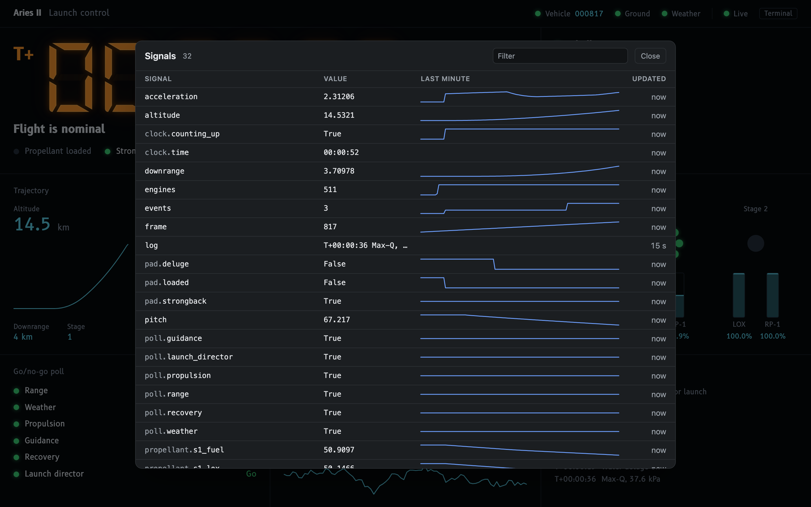
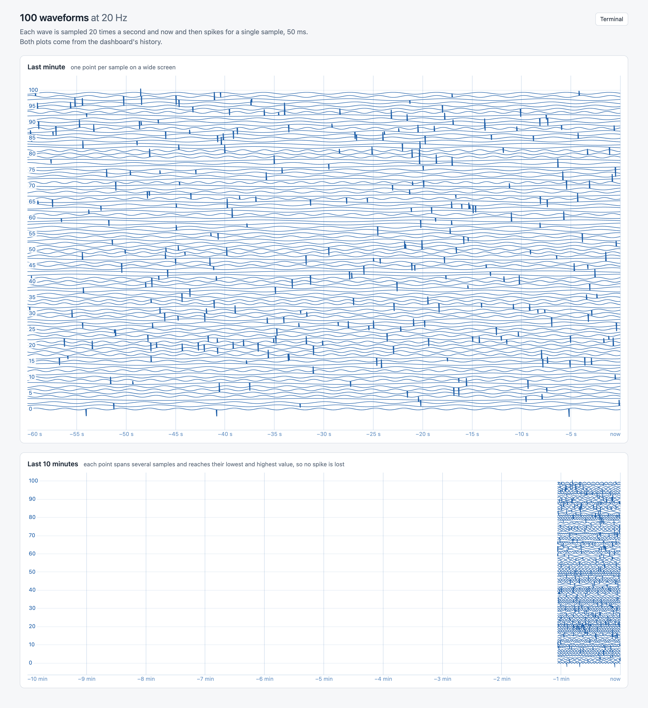

# Pages: custom HTML, plots, themes and the terminal

A dashboard is shown by an output: `WebDashboard` serves it to browsers, and
`TerminalDisplay` draws it in a terminal. Without one, `start()` and `serve()`
use a `WebDashboard()` with the generic page, which shows every id.

## Serve your own page

```python
from sightglass import WebDashboard

web = WebDashboard(
    None,  # "page.html" for your own page; None for the generic one
    static_dir=None,  # a folder whose files are served under /static/
    host="127.0.0.1",
    port=8080,
    title="Dashboard",
    token=None,  # required to POST /update, if set
    theme="classic",  # or "terminal": see Themes below
    stale_after=None,  # e.g. 2: dim values when no data came for 2 s
    debug=False,  # keep-up figures in the signals view
    open_browser=False,
)
# then: monitor.start(outputs=[web])
```

It serves the page, streams values over a WebSocket, accepts `POST /update`
and returns the current values as JSON from `GET /values`. Your page loads
`/_sightglass/sightglass.js` and marks up elements; it needs no JavaScript of
its own:

```html
<link rel="stylesheet" href="/_sightglass/instruments.css">

<span data-bind="temperature"></span>                                  <!-- text -->
<div class="led" data-bind="machine.estop" data-mode="state"></div>    <!-- data-state="on"/"off" -->
<div class="bar" data-bind="X.velocity.ratio" data-mode="width"></div> <!-- width: 0-100% -->
<div data-bind="rate.values" data-mode="sparkline"></div>              <!-- line chart -->
<div class="dial" data-bind="pressure.ratio" data-mode="var"></div>    <!-- CSS variable --value -->
<div data-bind="events" data-mode="log"></div>                        <!-- a <div> per line, with data-level -->
<span data-bind="wind" data-stale-after="3"></span>                    <!-- data-stale="true" once quiet -->

<!-- A segment display: data-ghost draws the unlit segments. -->
<div class="lcd">
  <span class="lcd-field" data-ghost="~~~~~~.~~~"><span data-bind="position_x"></span></span>
</div>

<script src="/_sightglass/sightglass.js"></script>
```

`data-mode="log"` draws a `LogMonitor` a `<div>` per line. A line that starts
with its level, after the time if it has one (`12:00:03 ERROR ...`,
`WARNING: ...`), gets `data-level="debug"`, `"info"`, `"warning"` or
`"error"` (for `ERROR`, `CRITICAL` and `FATAL`), so CSS can colour it:
`[data-level="error"] { color: red }`. `LogHandler` writes lines that way.

`data-mode="var"` sets the CSS variable `--value` to the number, so CSS alone
can draw a needle (`rotate: calc(var(--value) * 270deg)`) or a fill level
(`height: calc(var(--value) * 100%)`). `data-stale-after="<seconds>"` marks an
element `data-stale="true"` while its value hasn't arrived for that long, so a
page fed by several sources can show which one has gone quiet
(`stale_after` does this for the page as a whole).

Object values are flattened, so a `RangeBar` binds as `<id>.text` and
`<id>.ratio`, a `Sparkline` as `<id>.text` and `<id>.values`, and a
`MachineState` as `<id>.<state>`. `instruments.css` provides the segment display
(`.lcd`, `.lcd-field`) and LED (`.led`, `.led-red`, `.led-amber`) styles.
Files in `static_dir` are served under `/static/`.

## Check what arrives: the signals view

Every page that loads `sightglass.js` (the generic page, the launch demo,
yours) has a view for checking what a feed sends: press `` ` `` (or click
**Signals** on the generic page, or an element of yours marked
`data-signals-open`). It lists every id the dashboard has accepted, its latest
value as sent (before an element scales or formats it), how long ago it
arrived, and a chart of its last minute. With `debug` on (`--debug`, or
`WebDashboard(debug=True)`; off by default, since measuring costs the page a
little) the view also shows labelled figures for whether things keep up, over
the last second and only while it is open. With REST or InfluxDB sources,
each has its polls a second and how long the last and slowest recent polls
took: a service that answers slowly shows here. **Page** is the browser's own:
frames a second, the longest frame and long tasks that blocked it. **Values**
(on pages with live values) is how long the dashboard's messages waited for the
page and took to apply, and how many updates the server folded into others, as
it does for a page that is too slow. **Plots** is how quickly they got their
points. A figure turns amber when it shows trouble: under 24 frames a second, or
a frame, a task or a wait over 100 ms. The charts share one time axis, so
what changed together lines up; the line reaches the lowest and highest value
of each half second, so a fast swing isn't lost, and booleans and on/off chart
as steps. Type to filter by id; `` ` `` or Escape closes it. It streams over a
WebSocket of its own (`/ws/signals`) only while open.



## Plot values against time

To plot values against time over minutes, keep their history:
`sightglass --history 600`, or `Monitor(history=600)` in Python. The dashboard
then records every id that sends a number, as sent, in 50 ms slots for the
last 600 seconds. `GET /history` returns any of those ids, reduced to the
number of points a plot needs:

```bash
sightglass --history 600 &
curl -d 'speed=3' http://127.0.0.1:8080/update
curl 'http://127.0.0.1:8080/history?id=speed&seconds=60&points=600'
```

```json
{"start": 1763900000.05, "step": 0.15, "points": 401, "signals": {"speed": [null, 3, [2.5, 4], 3]}}
```

The `signals` list shows four of the 401 points.

- **Choose the ids:** repeat `id` for each one, up to 10,000 per request. `*`
  matches any characters: `id=wave.*` is every id that starts `wave.`.
- **Choose the window:** give `seconds` (the last that many, the whole history
  by default), or `from` and `to` as Unix times.
- **Choose the number of points:** `points` is the most you want, from 2 to
  10000 (default 600); use the plot's width in pixels. You may get fewer, as
  here, because each point covers a whole number of 50 ms slots, and because
  one answer holds at most a million points in all (5000 ids get 200 each).
  Or give `step`, in seconds per point, in place of `points`.

Each point covers `step` seconds, starting at `start` (a Unix time). A point
is the value, `[lowest, highest]` when it changed during the point, so a short
spike still shows, or `null` where there was no number. Points start at
multiples of `step`, so asking again for a window of the same length returns
the same points plus any new ones. An id with no history is `null`.

History costs 8 bytes per slot per id that sends numbers: 96 MB for 1000 ids
over 10 minutes. Recording 1000 values 20 times a second takes about 2% of a
CPU core. Reducing 10 minutes of one id takes about 1 ms. Values are kept as
float32, about 7 significant digits, which is more than a plot can show.
`GET /values` keeps the exact values.

### Draw a plot on a page

A page plots them without any JavaScript of its own: a `data-plot` element
draws the ids it names over the last `data-seconds` seconds.

```html
<div data-plot="wave.* level" data-seconds="60" style="height: 400px"></div>
<script src="/_sightglass/sightglass.js"></script>
```

Separate several ids or patterns with spaces. The lines and labels use the
element's CSS `color` and `font`. The plot loads its window once, at about one
point per pixel. It then asks only for points since its newest one, once per
point and at most 20 times a second, and draws each point from its lowest to
its highest value. While it can't get points, the element has
`data-plot-error` with the reason, for example a dashboard without
`--history`.

- **Units and scale:** history keeps values as sent, so an element's `scale`
  and `units` don't reach a plot. Give the plot its own:
  `data-plot-units="MB"` after each value label, and `data-plot-scale` to
  multiply the values first (`0.00000095367431640625` turns bytes into MB).
- **The value axis** is labelled at round values, about three lines of text
  apart, all with the same decimals. A value of 10,000 or more is shortened
  with k, M or G (`200M`, or `200 MB` with units `B`).
- **Colours:** two to eight ids are drawn each in its own colour, with a
  legend at the top right naming them, less the part their names share
  (`jobs.queue jobs.p95` gives `queue` and `p95`). The colours suit a light
  or a dark background, whichever the plot has. One id, or more than eight,
  are drawn in the element's `color`, as one shape.
- **One scale per plot:** ids plotted together share the value axis, so plot
  values of different units, or of very different sizes, in plots of their
  own.

The element gets `data-plot-signals` (how many ids it draws),
`data-plot-range` (the lowest and highest value in view), `data-plot-ticks`
(the value labels) and, with colours, `data-plot-legend`.

`sightglass --demo plot --open` plots 100 waveforms sampled 20 times a second,
each with an occasional spike one sample long. The last minute shows every
sample. The last 10 minutes shows several samples per point, and every spike
still shows.



### A heat map, for thousands of ids

For more ids than lines can show, `data-plot-mode="heatmap"` draws a row per
id and a cell per point. A cell's strength is how far its value is from the
id's usual value, in units of its usual spread: faint while a signal does
what it usually does, full color with a mark where it goes four spreads or
more from it. So a glitch, a step or a drift stands out among thousands of
ordinary signals.
## Themes: classic and terminal

The generic page and the launch demo come in two themes: **classic**, and
**terminal**, a phosphor-green terminal whose instruments borrow from an early
glass cockpit's CRTs: gauges with filled sectors, caution bands and red limits,
boxed readouts, scales, and a red X over anything whose data has stopped. Its
CRT effects, on a switch of their own, are still (glow, scanlines, the tube's
rounded corners and glass) and moving (a power-on that draws each box
and types its name, the refresh rolling down the screen, a faint flicker); the
moving ones are left out for anyone whose system asks for reduced motion.


`--theme terminal` or `WebDashboard(theme="terminal")` sets the default; a
switch on the page lets each viewer change it, and their browser remembers.
Your own page can offer both:

```html
<head>
  <script src="/_sightglass/theme.js"></script>          <!-- html[data-theme], html[data-crt] -->
  <link rel="stylesheet" href="/_sightglass/terminal.css"> <!-- fonts, --crt-* colours, CRT effects -->
</head>

<button data-theme-switch>Terminal</button>  <!-- aria-pressed while the terminal theme is on -->
<button data-crt-switch>CRT</button>
```

then style it under `html[data-theme="terminal"]` with the `--crt-*` colours
(`--crt-fg`, `--crt-dim`, `--crt-bright`, `--crt-amber`, ...) and fonts:
`--crt-font` (VT323) for text, and two pixel fonts for numbers,
`--crt-display-font` (Micro 5) for a big display like a clock and
`--crt-readout-font` (Silkscreen) for readings. Pixel fonts are sharp only at
whole pixels: give Micro 5 multiples of 11px and Silkscreen multiples of 8px.
`terminal.css` draws the CRT effects over any page; for the power-on, give
your boxes its keyframes, `crt-draw` (drawn top to bottom, with `steps()`)
and `crt-type` (typed in), inside
`@media (prefers-reduced-motion: no-preference)`. `theme.js` sets the theme
before anything is drawn, so the page never flashes the other one.

## Draw in the terminal


**`TerminalDisplay(width=60, fps=30, screen=None)`** draws a full-screen view
in the terminal's alternate screen. Log to a file while it runs; anything
printed to the terminal gets drawn over. By default it lists every element;
for a layout of your own, the terminal's counterpart of a custom page, pass
`screen`: a function of `(monitor, width, height)` that returns the whole
frame for a terminal that size, reading values from the elements
(`monitor["rate"].text`) and colouring them with `Style`. A screen is redrawn
at least once a second, so it can show how old values are
(`monitor.ages()`). The launch demo's `screen.py` is a full example.

