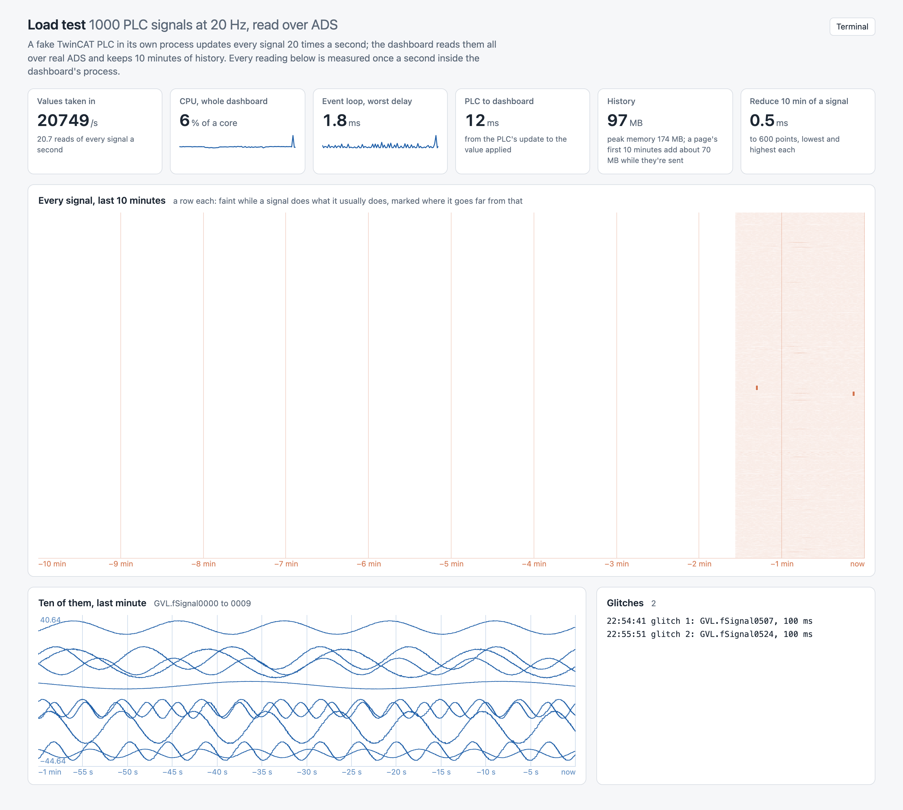

# How fast it is: the load demo

`sightglass --demo load --open` reads a fake TwinCAT PLC, in a process of its
own, over real ADS: 1000 REAL variables updated 20 times a second, read
every 50 ms in sum reads of 500. The page shows a heat map of every signal
over the last 10 minutes, ten of them as lines, and what it all costs,
measured once a second inside the dashboard's process. 10 to 20 seconds in,
and then every 40 to 80 seconds, one signal glitches for 100 ms; the log
names it and the heat map marks it. It needs the ads extra
(`pip install "sightglass[ads]"`), Linux or macOS, and port 48898 free. To
change the load, run the demo as a module, with the Python that has
sightglass installed:

```bash
python -m sightglass.load --signals 2000 --rate 50 --open
```

From a clone of this repository, put `uv run` in front: `uv run python -m
sightglass.load ...`.



Measured on an Apple M5 Pro (macOS 27, Python 3.14), with one page open:

| Load | Values a second | CPU, one core | Worst event-loop delay | PLC to dashboard | Memory |
| --- | --- | --- | --- | --- | --- |
| 1000 signals at 20 Hz | 19,700 | 9–11% | 6 ms | 10 ms | 156 MB |
| 2000 signals at 20 Hz | 40,000 | 10–13% | 3 ms | 12–14 ms | 249 MB |
| 1000 signals at 50 Hz | 50,000 | 16–18% | 5 ms | 6–7 ms | 157 MB |
| 5000 signals at 20 Hz | 98,000–103,000 | 22–23% | 6 ms | 19–21 ms | 555 MB |

Memory is mostly history: 8 bytes per 50 ms slot per signal, kept for 10
minutes. The fake PLC's own CPU isn't counted; a real PLC does that work.


## What each open page is sent

A page's live connection sends an id each time the source sets it, because a
value that arrives again counts as arriving (it resets `data-stale-after`).
Only ids whose value changed carry the value: one that arrived again with the
value that page already has is listed by id in `"fresh"` of the update, and
the page treats it as arrived without redrawing it.

Measured on a fake endpoint of 915 ids (183 workers of five fields each: an
`id` string, and four numbers like `123.456`; ids like
`api.resources.workers.12.cpu`) polled every 0.2 s, with 45 numbers (5%)
changing each poll, one page, bytes of WebSocket text per second:

| | Every id sent in full | Unchanged ids in `fresh` |
| --- | --- | --- |
| 915 ids at 5 polls a second | 229 KB/s | 156 KB/s |

A fresh id still costs its name (about 30 bytes here), so the saving grows
with the length of the values and the share that is steady, not with the
number of ids alone; a page's cost is still ids x polls a second x pages.
For the generic page, a few hundred ids polled every second or two is
comfortable; at 900 ids polled five times a second expect about 150 KB/s to
each page.


## Trends on the generic page

With `--history`, the generic page draws a small trend beside each value that
history records (a number), the way a `Sparkline` is drawn. One request a
second feeds them all: `GET /history?id=*&seconds=60&step=1` when the page
opens, then only the points since the last one. Ids that are not numbers come
back with no history and get no trend. Without `--history` the page is
unchanged.

Measured in headless Chromium on Linux, values changing twice a second, the
page's own work (including showing the values) from Chrome's task timer:

| Numeric ids | Request, each second | Page, one core |
| --- | --- | --- |
| 100 | 4.6 KB | 3% |
| 1000 | 58 KB | 11% |
| 5000 | 240–300 KB | 51% |

Past **1000 values** on the page, it draws no trends and says so at the top
of the page: that is the count the page keeps up with comfortably. (The count
is of all values, numbers or not.) Pages with a `trend` panel or a
`data-plot` are not affected.

Screenshots in both themes at desktop and 390 px are in `docs/trends/`.
