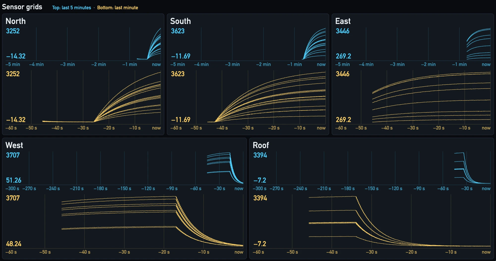
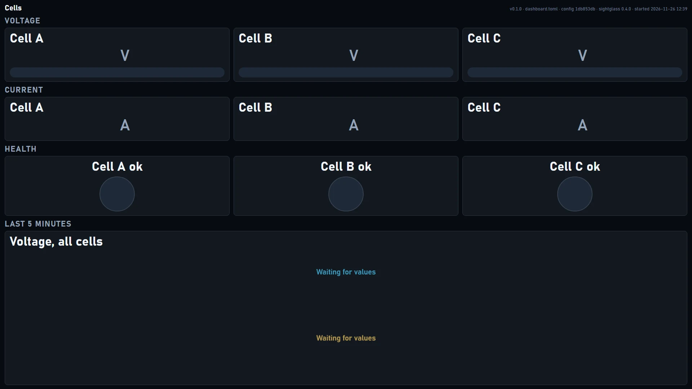

# Examples

Each example shows one way to get live values onto a dashboard, and runs with
one command. The dashboard opens in your browser; stop with Ctrl+C.

The commands use [uv](https://docs.astral.sh/uv/), which fetches everything an
example needs on the fly: no clone, no virtualenv. Install it once with
`curl -LsSf https://astral.sh/uv/install.sh | sh` (macOS, Linux) or
`powershell -c "irm https://astral.sh/uv/install.ps1 | iex"` (Windows).

Without uv: `pip install "sightglass[web]"`,
download the example, and run it with `python`.

## Start here: the demo

Every kind of display, with simulated data:

```bash
uvx --from "sightglass[web]" sightglass --demo --open
```

## The showcase: launch control

A rocket launch, live, on a hand-built page: countdown clock, gauges, engine
lamps, propellant tanks, a go/no-go poll, weather and an event log. The page
is plain HTML and CSS, and three separate programs feed it, each its own way:
the vehicle's telemetry is a source inside the dashboard program, ground
systems report from another process with `Client`, and the weather mast posts
plain HTTP with no library at all. Stop one of them and its part of the page
says it has gone quiet.


```bash
uvx --from "sightglass[web]" sightglass --demo launch --open
```

The launch repeats every five minutes or so; `--theme terminal` shows it as a
phosphor terminal, and the switch on the page changes it. It ships with
sightglass, so once installed, `sightglass --demo launch --open` is enough. Its source is in
[src/sightglass/launch/](../src/sightglass/launch/): copy the folder as a
starting point for a page of your own.

## Plots against time

100 waveforms sampled 20 times a second, each with an occasional spike one
sample long, on two live plots: the last minute and the last 10 minutes. The
page is plain HTML: each plot is a `data-plot` element.

```bash
uvx --from "sightglass[web]" sightglass --demo plot --open
```

## How fast it is: a fake PLC under load

A fake TwinCAT PLC, in a process of its own, updates 1000 signals 20 times a
second; the dashboard reads them all over real ADS and shows what that costs,
measured as it runs: values a second, CPU, the event loop's worst delay, the
delay from PLC to dashboard, memory. A heat map shows every signal over the
last 10 minutes and marks the rare glitch. Needs Linux or macOS (it reads
the fake PLC with pyads, the `ads` extra).

```bash
uvx --from "sightglass[web,ads]" sightglass --demo load --open
```

For more load, run it as a module with the Python that has
`sightglass[web,ads]` installed (from a clone, put `uv run` in front):

```bash
python -m sightglass.load --signals 5000 --rate 20 --open
```

## 1. Hello, dashboard

A Python program reports what it's doing with `start()` and `set()`. Nothing
is declared: each value gets a display the first time it's set.
[01_hello.py](01_hello.py)

```bash
uv run https://raw.githubusercontent.com/davidson-engineering/sightglass/main/examples/01_hello.py
```

## 2. System monitor

This computer's CPU, memory, disk, network and busiest processes. Shows how to
choose the displays: charts for trends, bars for capacity, a table, groups.
[02_system_monitor.py](02_system_monitor.py)

```bash
uv run https://raw.githubusercontent.com/davidson-engineering/sightglass/main/examples/02_system_monitor.py
```

## 3. From the shell

Any language can feed a dashboard over HTTP. This bash script starts one and
posts readings with `curl`. [03_from_the_shell.sh](03_from_the_shell.sh)

```bash
curl -fsSL https://raw.githubusercontent.com/davidson-engineering/sightglass/main/examples/03_from_the_shell.sh | bash
```

## 4. Pipe a program's output

A program that only prints: lines of `key=value` pairs become values, and its
other output still shows in the terminal. The program needs no dashboard code
at all. [04_pipe.py](04_pipe.py)

```bash
uv run https://raw.githubusercontent.com/davidson-engineering/sightglass/main/examples/04_pipe.py | uvx --from "sightglass[web]" sightglass --open
```

## 5. Many processes, one dashboard

Four worker processes report their progress with `Client`, which needs only
the standard library. In a real system they could be separate programs on
separate machines. [05_many_processes.py](05_many_processes.py)

```bash
uv run https://raw.githubusercontent.com/davidson-engineering/sightglass/main/examples/05_many_processes.py
```

## 6. Deploy with Docker

The dashboard as a service, and a second container feeding it over the
network with a token. Stop the feeder (`docker compose stop feeder`) to see
the page flag the missing data after 5 seconds. [docker/](docker/)

```bash
git clone https://github.com/davidson-engineering/sightglass
cd sightglass/examples/docker
docker compose up
```

Then open <http://localhost:8080>. The port is only reachable from this
machine; see `compose.yaml` to share it, and set `TOKEN` to your own secret.

## 7. In the terminal

The launch showcase, drawn in the terminal by a screen function of its own
([screen.py](../src/sightglass/launch/screen.py)); it still serves the page
too. Two layouts: the full one from 101 x 34, a compact one down to 80 x 24.


```bash
uvx --from "sightglass[web]" sightglass --demo launch --terminal
```

A three-axis machine drawn in the terminal instead of a browser, with the
default layout (every element listed). [terminal_axes.py](terminal_axes.py)

```bash
uv run https://raw.githubusercontent.com/davidson-engineering/sightglass/main/examples/terminal_axes.py --simulate
```

`--zmq tcp://localhost:5556` reads [zmq_publisher.py](zmq_publisher.py)
instead, and `--port /dev/ttyUSB0` a device sending binary frames.

## 8. A custom page (and a serial device)

A hand-built control page with segment displays and LEDs, written in plain
HTML with `data-bind` attributes. It reads a microcontroller over serial, or
simulated data. [robot_dashboard/](robot_dashboard/)


```bash
git clone https://github.com/davidson-engineering/sightglass
cd sightglass
uv run --all-extras examples/robot_dashboard/dashboard.py --simulate
```

No microcontroller? On macOS or Linux, [fake_device.py](fake_device.py) creates
a virtual serial port that streams to the page, so you can exercise the real
serial path: run `uv run --all-extras examples/fake_device.py` and pass the
port it prints to the dashboard with `--port`.

## 9. A Beckhoff PLC over ADS

Variables from a TwinCAT PLC, described in an interface file: the PLC's
address, the variables to show, struct and enum types pasted from the PLC
project, and the one variable that may be written. [plc.toml](plc.toml) is
commented; download it, change `target` and the variables to match your PLC,
and run:

```bash
uvx --from "sightglass[web,ads]" sightglass --ads plc.toml --open
```

This one needs a PLC, or a PC running a TwinCAT runtime. On
Linux and macOS the PLC needs a route to this computer; sightglass says what
to add if it doesn't answer. Writing also needs `--allow-writes`, `--token`
and `SIGHTGLASS_ALLOW_WRITES=1`: see
[the README](../README.md#beckhoff-twincat-plcs-ads).

## 10. A dashboard from a config file (a REST API)

A whole dashboard in one TOML file: where the values come from (a web service
that answers GET with JSON, polled five times a second) and what to show. No
code and no page to write. Examples 10 to 12 are built the same way, and share
the words the README defines (dashboard, source, section, panel, plot): a
folder with `dashboard.toml`, commented line by line, a stand-in for the real
source (`fake_*.py`), so each runs with nothing else installed, and
`dashboard.py`, which starts the stand-in and runs `sightglass --config` on the
file. To use the real source, copy the file and change its `[[source]]`.

Each of five sensor arrays gets a `trend` panel with lines for its first
row of cells over the last 5 minutes and, bigger, the last minute, on a dark
page with large text for reading from across a room. The panels wrap like
Grafana's as the screen changes size. [rest_grid/](rest_grid/dashboard.toml)
starts a fake API ([rest_grid/fake_api.py](rest_grid/fake_api.py)).



```bash
git clone https://github.com/davidson-engineering/sightglass
cd sightglass
uv run --all-extras examples/rest_grid/dashboard.py            # the fake API
uv run --all-extras examples/rest_grid/dashboard.py http://host:8000/api/arrays
```

For your own API, copy `dashboard.toml`, change the `url`, `prefix`, `select`
and the panels, and run `sightglass --config your.toml`. The README describes
every key.

## 11. A PLC as readings and plots (ADS)

The same file format over a different source, and with every kind of panel,
in two sections. [ads_press/](ads_press/dashboard.toml) reads a Beckhoff
TwinCAT PLC over ADS: a `gauge` for pressure, `value` panels for the
temperature and the parts count, a `lamp` for each of two flags, and below
them `trend` panels of the pressure and temperature. The PLC's variable
names are the ids. `ads_press/fake_plc.py` is a fake PLC; edit the file's
`target` and `variables` (or set `PLC_TARGET`) to read a real one.

```bash
uv run --all-extras examples/ads_press/dashboard.py            # a fake PLC
PLC_TARGET=5.12.34.56.1.1 sightglass --config examples/ads_press/dashboard.toml
```

The fake PLC needs Linux or macOS: on Windows, pyads needs TwinCAT's own ADS
router, which can't reach it. A dashboard never writes to a PLC.

## 12. A database as readings and plots (InfluxDB)

[influx_cells/](influx_cells/dashboard.toml) reads an InfluxDB 2.x bucket of
battery cells: the newest point of each series, one `gauge`, `value` and
`lamp` per cell, and a `trend` panel of all the voltages. A series with
no point in the last `window` seconds goes blank (cell C is quiet for ten
seconds in every forty), never its last value. The token comes from the
environment, so it stays out of the file. `influx_cells/fake_influx.py` is a
fake server that answers in Flux's annotated CSV.

```bash
uv run --all-extras examples/influx_cells/dashboard.py             # a fake InfluxDB
INFLUX_TOKEN=... uv run --all-extras examples/influx_cells/dashboard.py http://host:8086
```



For your own bucket, edit the file's `org`, `bucket`, `measurement` and the ids
its panels show. The README describes every key.
